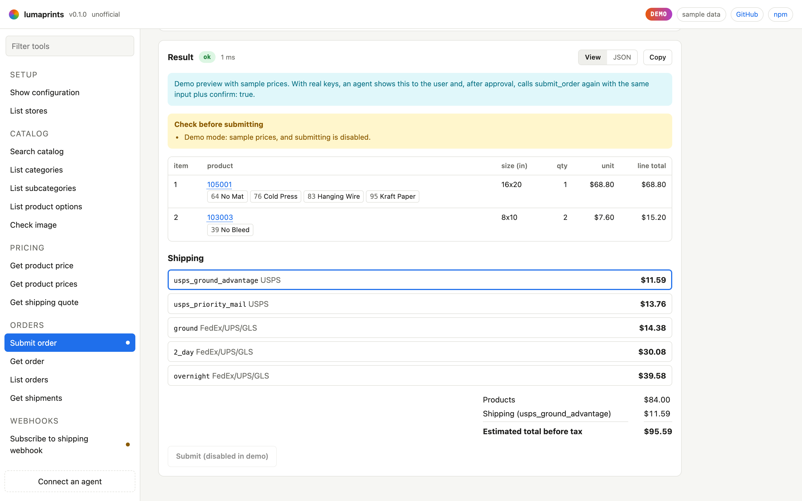
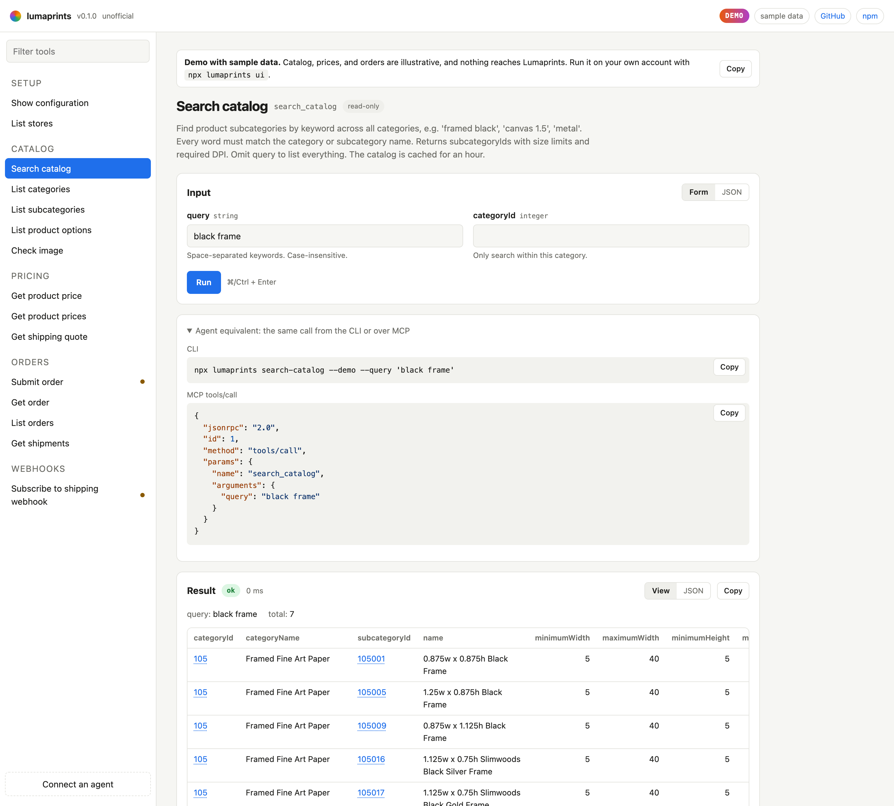

<p align="center">
  <a href="https://lumaprints.vercel.app">
    
  </a>
</p>

<p align="center">
  <a href="https://www.npmjs.com/package/lumaprints"></a>
  <a href="https://github.com/comountainclimber/lumaprints/actions/workflows/ci.yml"></a>
  
  
  
  <a href="LICENSE"></a>
</p>

<p align="center">
  <a href="https://lumaprints.vercel.app"><b>Try the live demo</b></a>
  &nbsp;·&nbsp; <a href="#quick-start">Quick start</a>
  &nbsp;·&nbsp; <a href="#connect-an-agent">Connect an agent</a>
  &nbsp;·&nbsp; <a href="#tools">Tools</a>
  &nbsp;·&nbsp; <a href="#safety-model">Safety model</a>
</p>

**lumaprints** lets AI agents, scripts, and people use [Lumaprints](https://www.lumaprints.com), the print-on-demand lab for canvas, fine art paper, and framed prints, without ever placing an order by accident.

One registry of 15 tools, four ways in:

| | |
|---|---|
| **MCP server** | `npx lumaprints mcp` for Cursor, Claude, and any other MCP client |
| **JSON CLI** | `npx lumaprints get-product-price --subcategory-id 103001 --width 8 --height 10` |
| **Typed SDK** | `import { createLumaprintsClient } from "lumaprints"` |
| **Local GUI** | `npx lumaprints ui`: every tool as a form, with the matching CLI and MCP call beside it |

Zero runtime dependencies. Sandbox by default. Every order is previewed with real prices before anything is submitted.

> [!NOTE]
> Unofficial. Not affiliated with or endorsed by Lumaprints. "Lumaprints" is their trademark, used here only to say what this package talks to.

<picture>
  <source media="(prefers-color-scheme: dark)" srcset="https://raw.githubusercontent.com/comountainclimber/lumaprints/main/docs/screenshots/order-preview-dark.png">
  
</picture>

## Quick start

No account needed to look around. `--demo` runs every tool against built-in sample data, with no keys, no network calls, and order submission switched off:

```bash
npx lumaprints ui --demo --open
```

With your own [sandbox keys](#getting-sandbox-keys):

```bash
export LUMAPRINTS_API_KEY=your-sandbox-key
export LUMAPRINTS_API_SECRET=your-sandbox-secret
npx lumaprints ui --open
```

A `.env` file in the current directory is loaded automatically.

## Connect an agent

**Cursor, Claude Desktop, and most MCP clients** (`~/.cursor/mcp.json`, `claude_desktop_config.json`, ...):

```json
{
  "mcpServers": {
    "lumaprints": {
      "command": "npx",
      "args": ["-y", "lumaprints", "mcp"],
      "env": {
        "LUMAPRINTS_API_KEY": "your-sandbox-key",
        "LUMAPRINTS_API_SECRET": "your-sandbox-secret"
      }
    }
  }
}
```

**Claude Code:**

```bash
claude mcp add lumaprints -e LUMAPRINTS_API_KEY=... -e LUMAPRINTS_API_SECRET=... -- npx -y lumaprints mcp
```

**No keys yet?** Point your agent at the demo data and ask it to price a framed 16x20:

```bash
claude mcp add lumaprints-demo -- npx -y lumaprints mcp --demo
```

On connect, the server sends the agent a short playbook (check the environment, find a product, check the image, price it, preview, get approval, then submit) along with every tool's JSON Schema. The MCP server is implemented from the spec with no SDK dependency and is tested against the official `@modelcontextprotocol/sdk` client.

### In your own agent

The registry is plain data plus a `runTool` function, so it drops into any function-calling API or agent framework:

```ts
import { createToolContext, runTool, toolDefinitions } from "lumaprints/tools";

const ctx = createToolContext(); // reads LUMAPRINTS_* from process.env

// Hand these to your model (Anthropic shown; OpenAI uses `parameters`).
const tools = toolDefinitions().map((t) => ({
  name: t.name,
  description: t.description,
  input_schema: t.inputSchema,
}));

// When the model calls a tool: input is validated, errors come back as typed codes.
const result = await runTool(call.name, call.input, ctx);
```

## The console

`npx lumaprints ui` serves a single-page console on `127.0.0.1:4848`. Every tool gets a form generated from its schema, a JSON mode, and the exact CLI command and MCP `tools/call` for the same input, so whatever you try by hand, an agent can repeat.

<picture>
  <source media="(prefers-color-scheme: dark)" srcset="https://raw.githubusercontent.com/comountainclimber/lumaprints/main/docs/screenshots/catalog-dark.png">
  
</picture>

It stays on your machine on purpose: it binds to loopback, rejects foreign `Host` headers (so DNS rebinding can't reach it), accepts only same-origin JSON, and ships a strict per-request CSP. The [hosted demo](https://lumaprints.vercel.app) is the same console running `--demo`, which holds no credentials.

## CLI

Every tool is a subcommand. Flags are typed from the tool's schema, output is JSON on stdout, and errors are JSON on stderr.

```bash
npx lumaprints search-catalog --query "framed black"
npx lumaprints list-subcategory-options --subcategory-id 105001
npx lumaprints check-image --subcategory-id 103001 --print-width 8 --print-height 10 --image-url https://example.com/art.jpg
npx lumaprints get-shipping-quote --input @quote.json
npx lumaprints submit-order --input @order.json                 # preview only
npx lumaprints submit-order --input @order.json --confirm true  # submits
npx lumaprints help submit-order                                # flags + JSON Schema
```

Exit codes: `0` success, `1` tool or API error, `2` bad usage or invalid input.

## SDK

A small typed client over the REST API. It runs anywhere with `fetch` (Node 22+, Bun, Deno, edge runtimes).

```ts
import { createLumaprintsClient } from "lumaprints";

const luma = createLumaprintsClient({
  apiKey: process.env.LUMAPRINTS_API_KEY!,
  apiSecret: process.env.LUMAPRINTS_API_SECRET!,
  environment: "sandbox", // never silently falls back to the other environment
});

const { price } = await luma.getProductPrice({ subcategoryId: 103001, width: 8, height: 10 });
const quote = await luma.getShippingQuote({
  recipient: { addressLine1: "123 Main St", city: "New York", state: "NY", zipCode: "10001", country: "US" },
  orderItems: [{ subcategoryId: 103001, quantity: 1, width: 8, height: 10 }],
});
```

Rate limits (40 requests a minute) are retried automatically using the `x-ratelimit-reset` header. Failures throw a `LumaprintsError` with `status`, `body`, and `rateLimit`, plus hints for the common mistakes, like using sandbox keys against production.

## Tools

| Tool | | What it does |
|---|:-:|---|
| `get_config` | | Active environment, credentials, default store, and whether orders can be submitted |
| `list_stores` | | The account's Standard Stores |
| `search_catalog` | | Find products by keyword across every category, e.g. `framed black` |
| `list_categories` | | Top-level categories |
| `list_subcategories` | | Products in a category with size limits and required DPI |
| `list_subcategory_options` | | Option groups for a product: paper, mat, hanging hardware, wrap |
| `check_image` | | Whether an image's aspect ratio and resolution fit a print size |
| `get_product_price` | | Unit price for one configuration |
| `get_product_prices` | | Price many configurations in one call |
| `get_shipping_quote` | | Every shipping method and cost for a destination |
| `submit_order` | ⚠️ | Preview an order with prices; submits only with `confirm: true` |
| `get_order` | | Status, items, recipient, and totals |
| `list_orders` | | A store's orders, newest first |
| `get_shipments` | | Carrier, tracking number, and ship date |
| `subscribe_webhook` | ⚠️ | Register a URL that Lumaprints calls when an order ships |

⚠️ marks the two tools with side effects. They carry MCP `destructiveHint` annotations, so well-behaved clients ask before running them. Everything else is read-only.

## Safety model

Lumaprints charges the store's card the moment an order is accepted, and orders can't be edited or canceled through the API. So:

- **Sandbox by default.** Production needs `LUMAPRINTS_ENV=production` and production keys. The client never retries one environment's keys against the other.
- **Preview first.** `submit_order` without `confirm: true` returns real unit prices, every shipping option, an estimated total, and warnings. It submits nothing.
- **Production is locked.** Even with `confirm: true`, production orders are refused until a human sets `LUMAPRINTS_ALLOW_LIVE_ORDERS=true`.
- **Retries can't double-order.** `externalId` is unique per store, and Lumaprints rejects duplicates.
- **No guessing which store.** With several stores and no `storeId`, tools stop and list them rather than pick one.

> [!WARNING]
> Lumaprints production has no test mode, and their docs say submitting test orders to production gets your API access permanently revoked. Test in the sandbox.

## Configuration

| Variable | |
|---|---|
| `LUMAPRINTS_API_KEY`, `LUMAPRINTS_API_SECRET` | Credentials from Developer > API Keys. Sandbox and production keys are separate. |
| `LUMAPRINTS_ENV` | `sandbox` (default) or `production` |
| `LUMAPRINTS_STORE_ID` | Default Standard Store. Optional when the account has exactly one. |
| `LUMAPRINTS_ALLOW_LIVE_ORDERS` | Must be `true` before any production order can be submitted |
| `LUMAPRINTS_BASE_URL` | Override the API base URL, e.g. for a local mock |

### Getting sandbox keys

1. Register at [sandbox.lumaprints.com](https://sandbox.lumaprints.com). It's a separate account from production, even with the same email.
2. Create a **Standard Store**. Stores connected through Shopify, WooCommerce, and other integrations can't take API orders.
3. Add a test card (for example `4111 1111 1111 1111`, any future date) and a billing address.
4. Generate keys under [Developer > API Keys](https://sandbox.lumaprints.com/developer/apiKeys).

Sandbox orders are accepted and priced but never move past their first status and never ship, so shipping webhooks don't fire there.

## Self-hosting the demo

The hosted demo is this repo deployed to Vercel as is: `api/demo.js` wraps the console's fetch handler around the sample-data backend, and `vercel.json` routes every path to it. Fork it and run `vercel deploy` to host your own.

## Development

```bash
pnpm install
pnpm test                    # node:test against a mock Lumaprints server
pnpm typecheck
pnpm dev:ui --demo           # console from source, sample data
pnpm dev:mock                # mock API on :4010 (pair with LUMAPRINTS_BASE_URL)
node scripts/screenshots.ts  # regenerate docs/screenshots with headless Chrome
```

Node 24 runs the TypeScript sources directly. The build emits plain ESM to `dist/`. See [AGENTS.md](AGENTS.md) for how the code is organized.

## License

[MIT](LICENSE) © Maxwell Lasky. Not affiliated with Lumaprints.
